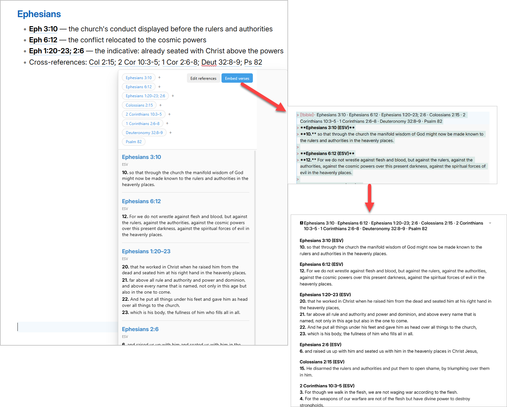

# Bible Reference Hover

Hover over a Bible reference in your notes to read the passage, then edit the references or embed the verses without leaving the note. On a phone or tablet, tap a reference to read just that passage.

Bible Reference Hover is an [Obsidian](https://obsidian.md) plugin. It finds every Bible reference in the paragraph, heading, or list around the one you hover, and shows all of their passages together in one preview, with the option to embed the verses into your note, as shown below.



_"Scripture quotations are from the ESV® Bible, © 2001 by Crossway."_

## Features

### Passage previews

- **Hover to preview.** References in your notes get a subtle dotted underline. Hover over one, or move to it with the keyboard, to see the passage.
- **Every reference in context.** The preview gathers all references in the surrounding paragraph, heading, or whole list, so a list of cross-references opens as one set of passages.
- **Works everywhere you read.** On desktop: Live Preview, Reading view, and selected text (right-click a selection, then select **Scan for Bible references**).
- **Readable output.** Duplicates are merged, references keep their order in the note, verse listings are grouped under chapter headings, and long passages scroll inside the preview.

### On iPhone, iPad, and Android

- **Tap to read.** Tap an underlined reference to open just that passage in a small window, with the heading, translation, and numbered verses. Close it to return to your note.
- **Reading view and Live Preview.** Tapping works in both. In Live Preview the cursor still moves to where you tapped, so you can keep editing.
- **Whole chapters scroll.** A chapter-only reference such as `Ps 82` shows every verse, and long passages scroll inside the window.
- **Desktop-only extras.** The multi-reference preview with **Edit references** and **Embed verses** is available on desktop, where you can hover.

### Flexible reference notation

All of these are recognized:

```text
Eph 2:3-4          colon notation
Eph. 2.3–4         period notation, abbreviation period, en dash
John 3.16-4:2      ranges across chapters
John 3:16, 18; 4:1 verse lists
1 John 1:9@esv     a specific translation for one reference
Ps 82              a whole chapter
Gen 1–3            a range of whole chapters
Jude 3             a verse in a one-chapter book
```

- **Whole chapters.** A reference without a verse previews the entire chapter. Your note keeps the wording you wrote; only the lookup expands it (for example, `Ps 82` fetches Psalm 82:1–8).
- **Fewer false matches.** Book names that are also common words or names, such as Dan, Mark, or Job, are treated as references only when another reference is in the same paragraph. Lowercase words and chapters that don't exist are ignored.
- **Safe around Markdown.** References inside code, links, frontmatter, and existing Bible callouts are left alone.

### Edit and embed

- **Edit references.** Fix or change references in the preview. Apply the change to the preview only, or update the note too.
- **Embed verses.** Insert the passages below the paragraph as a collapsible Bible callout, quote callout, or HTML details block. Your original text stays as it was.
- **Prints cleanly.** Exported PDFs show references as plain text, without the hover underline.

### Also included

These features come from the original [Bible Reference](https://github.com/tim-hub/obsidian-bible-reference) plugin:

- **Inline lookup.** Type `--` followed by a reference (for example `--John 3:16`) at the start of a line to insert the passage.
- **Verse of the day.** Type `--vod`, or use the **Verse Of The Day** commands.
- **Commands** for verse lookup, inserting a reference link without verse text, and switching translations.
- **Offline mode** with the bundled World English Bible.
- **Many translations and languages**, book-name localization, and links to Bible Gateway, Blue Letter Bible, Logos, STEP Bible, and Literal Word.
- **Formatting options** for verse numbers, separators, book and chapter tags, and outgoing links.

## Installation

### From GitHub releases

1. Download `main.js`, `manifest.json`, and `styles.css` from the [latest release](https://github.com/blubgit/bible-reference-hover/releases/latest).
2. Create the folder `<your vault>/.obsidian/plugins/bible-reference-hover/` and put the three files in it.
3. Restart Obsidian, then turn on **Bible Reference Hover** in **Settings → Community plugins**.

### With BRAT

Install the [BRAT](https://github.com/TfTHacker/obsidian42-brat) plugin, then add the beta plugin `blubgit/bible-reference-hover`.

### On mobile

BRAT works on mobile too. If you install manually on desktop and sync your vault with Obsidian Sync, turn on **Installed community plugins** in **Settings → Sync** so the plugin reaches your phone. Then restart Obsidian there.

> **Using the original Bible Reference plugin too?** Both plugins respond to `--` at the start of a line. Turn one of them off to avoid duplicate suggestions.

## Settings

Open **Settings → Bible Reference Hover**. Hover-related options:

| Setting                                               | What it does                                                          |
| ----------------------------------------------------- | --------------------------------------------------------------------- |
| **Enable Bible reference hover previews**             | Turns previews on or off, both hover on desktop and tap on mobile.    |
| **Hover delay**                                       | Desktop only. How long to hover before the preview opens (0–2000 ms). |
| **Default hover translation**                         | Translation used unless a reference ends with `@translation`.         |
| **Reading view previews** / **Live Preview previews** | Choose where references are detected, for hover and tap.              |
| **Detect chapter-only references**                    | Preview references like `Ps 82` as whole chapters.                    |
| **Embedded widget style** / **Initially collapsed**   | How embedded verses look when inserted.                               |

## Privacy and network use

- **Nothing is sent until you open a preview.** Detecting references happens entirely on your device.
- **Online translations** are fetched from the Bible text provider for the selected translation ([bible-api.com](https://bible-api.com), [Bolls Life](https://bolls.life), or [Bible SuperSearch](https://www.biblesupersearch.com)). Only the requested reference and translation are sent.
- **Offline mode** uses the bundled World English Bible and makes no network requests.
- **Verse of the day** requests the daily verse from [OurManna](https://ourmanna.com).
- No analytics, no telemetry, and no account required.

Translated Bible texts remain the property of their copyright holders. Check the translation's terms before republishing embedded verses.

## Development

This repository is a [Bun](https://bun.sh) workspace. The plugin source lives in `packages/obsidian-bible-reference`, and builds write `main.js` to the repository root.

```bash
bun install
bun run test   # build helper packages, then run all tests
bun run build  # type-check and bundle main.js
```

See [docs/dev-setup.md](docs/dev-setup.md) for the full workflow, including how to test a build in your vault.

## Attribution

Bible Reference Hover is derived from [Bible Reference](https://github.com/tim-hub/obsidian-bible-reference) by tim-hub and contributors. The hover previews, reference scanning, editing, and embedding are maintained by [blubgit](https://github.com/blubgit).

Distributed under the [MIT License](LICENSE).
